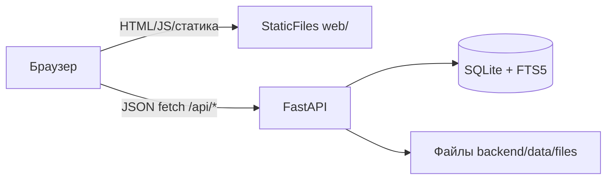
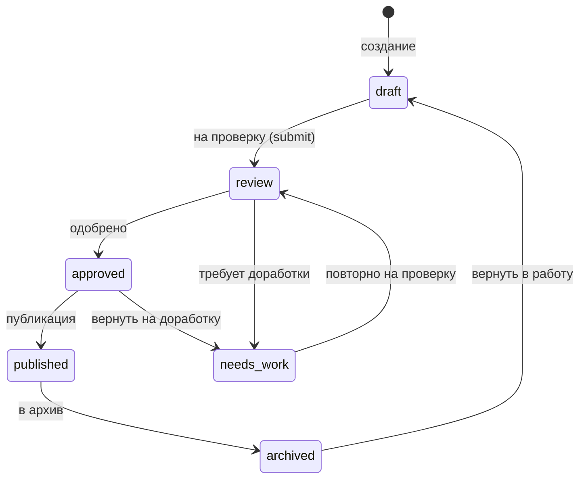

# Архитектура

Один процесс `uvicorn` раздаёт и статический сайт `web/`, и JSON API `/api/*`.
Стек: FastAPI + стандартный `sqlite3` (+ полнотекстовый поиск FTS5) + Pydantic v2,
без ORM. Статика ходит в API через `fetch` (обёртка `web/api.js`).

## Модули backend/app и их ответственность

| Модуль | Что делает |
|---|---|
| `main.py` | `create_app()`: собирает роутеры, подключает безопасность и статику; `/api/health` |
| `config.py` | `Settings` из переменных окружения (DB_PATH, WEB_DIR, FILES_DIR, AI_PROVIDER, DEEPSEEK_MODEL, DEEPSEEK_BASE_URL, OLLAMA_BASE_URL, OLLAMA_MODEL, OLLAMA_TIMEOUT, TTL, лимиты) |
| `db.py` | `connect()` (Row, WAL, foreign_keys), `init_schema()`, зависимость `get_db`, `fts5_available()` |
| `schema.sql` | Схема БД (таблицы и индексы ниже) |
| `models.py` | Pydantic-схемы ответов/запросов (UnitCard, SearchResponse, NewsItem и т. д.) |
| `permissions.py` | `can(user, action, obj)` — матрица прав, проверяется в каждом хендлере |
| `audit.py` | `log(...)` — запись в `audit_log` с вырезкой секретов из деталей |
| `security.py` | scrypt, сессии, лимит попыток, CSRF, заголовки, `install_security()` |
| `static.py` | `install_static()`: GZip, Cache-Control, кастомная 404, монтирование `web/` |
| `search.py` | `search_units()` (FTS5 + фолбэк LIKE), `reindex_unit()`/`reindex_all()` |
| `workflow.py` | `TRANSITIONS` и `transition()` — смена `pub_status` с проверкой прав и версиями |
| `textnorm.py` | `norm()`, синонимы городов, `expand_query()` — порт из браузерного каталога |
| `importer.py` | Импорт CSV/XLSX: `preview()`, `apply()`, автоподбор колонок, протокол ошибок |
| `ai/` | `retriever.py` (поиск фрагментов), `local.py` (шаблоны ответа), `providers.py` (выбор провайдера) |
| `routers/` | `catalog`, `branches`, `news`, `auth`, `admin`, `imports`, `ai`, `seo` |

Загрузка демо-данных — `backend/seed/`: `load.py` (`load_fixture` для тестов, `load_all` для полной
демо-БД), `demo_units.json`, `users.json`, `sample_import.csv`.

## Модель данных (таблицы)

- `branches` — филиалы (slug, названия, адрес, телефоны, координаты, `coords_verified`, `visible`).
- `fonds` / `inventories` — фонды и описи; иерархия фонд → опись → дело → документ.
- `units` — единицы хранения (уровень `fond|opis|delo|doc`), `pub_status` (статус описания).
- `unit_versions` — история версий: снимок данных, автор, согласующий, комментарий.
- `files` — файлы единицы: `access` (статус доступа к файлу), `sha256`, `kind` (master/view).
- `users` — роли `admin|moderator|editor|branch_admin`, `is_active`, привязка к филиалу.
- `sessions` — сессии (в БД sha256 токена), `login_attempts` — счётчик неудачных входов.
- `news` — новости, `audit_log` — журнал действий, `import_jobs` — задачи импорта.
- `catalog_fts` — виртуальная таблица FTS5 для полнотекстового поиска по опубликованному.

### Раздельные статусы описания и файла

Статусы описания `units.pub_status` и доступа к файлу `files.access` — **разные вещи**:

- `pub_status` отвечает на вопрос «описание опубликовано?». Публично видна только запись в статусе
  `published`.
- `files.access` отвечает на вопрос «можно ли скачать сам файл?»: `public` / `no_publish` /
  `needs_check`. Скачивание разрешено, только если запись опубликована **и** `access='public'`.

Так архив может опубликовать описание дела (люди видят, что оно есть и о чём), но оставить файл
закрытым до проверки на персональные данные — это ключевое требование ТЗ (прямая ссылка на файл
не должна обходить проверку). Переход статуса публикации **не меняет** `files.access` автоматически.

## Роли и матрица прав

Роли: `admin`, `moderator`, `editor`, `branch_admin`. `admin` может всё (короткое замыкание
в `permissions.can`). Матрица остальных — из `permissions.py`:

| Действие | admin | moderator | editor | branch_admin |
|---|---|---|---|---|
| unit.create / unit.submit | ✓ | ✓ | ✓ | ✗ |
| unit.edit (draft/review/needs_work) | ✓ | ✓ | ✓ | ✗ |
| unit.edit (published/archived) | ✓ | ✓ | ✗ | ✗ |
| unit.review / unit.publish / unit.archive | ✓ | ✓ | ✗ | ✗ |
| unit.delete | ✓ | ✗ | ✗ | ✗ |
| file.upload | ✓ | ✓ | ✓ | ✗ |
| file.set_access | ✓ | ✓ | ✗ | ✗ |
| branch.edit | ✓ (все) | ✗ | ✗ | ✓ только свой филиал |
| import.preview / import.apply | ✓ | ✗ | ✓ | ✗ |
| audit.read | ✓ | ✓ | ✗ | ✗ |
| users.manage | ✓ | ✗ | ✗ | ✗ |

Проверка прав выполняется на сервере в каждом хендлере; любой отказ пишется в `audit_log`
с `result='denied'`.

## Жизненный цикл материала

Каждый переход проверяется по `TRANSITIONS` (недопустимый — 409) и по правам (403). Каждое
изменение единицы пишет строку в `unit_versions` (снимок данных, автор, согласующий, комментарий).
Права на проверку/публикацию есть только у `moderator` (и `admin`).

## Безопасность

- **Пароли** — `hashlib.scrypt` (N=16384, r=8, p=5, 16 МиБ, соль 16 байт, сравнение через `hmac.compare_digest`);
  параметры хранятся в строке хеша, поэтому старые хеши p=1 продолжают проверяться.
- **Сессии** — случайный токен `secrets.token_urlsafe(32)`, в БД хранится только sha256;
  cookie `gos_session` HttpOnly, SameSite=Lax, Secure по настройке `COOKIE_SECURE`.
- **Автовыход** — 30 минут неактивности (`SESSION_TTL_MIN`), срок продлевается при каждом запросе.
- **Лимит входов** — 5 неудачных попыток за 10 минут на username+IP и 30 на IP по всем логинам → 429;
  для неизвестного логина scrypt считается против фиктивного хеша, ответ одинаковый; записи
  `login_attempts` старше суток удаляются. За прокси нужен `FORWARDED_ALLOW_IPS`.
- **CSRF** — SameSite=Lax + обязательный заголовок `X-Requested-With: gos` на любом mutating `/api/*`
  (без него 403 с `{"error":"csrf"}`).
- **Заголовки** — CSP, `X-Content-Type-Options: nosniff`, `Referrer-Policy`,
  `X-Frame-Options: DENY`, `Permissions-Policy`, `Cross-Origin-Opener-Policy` и
  `Cross-Origin-Resource-Policy: same-origin`, HSTS при `COOKIE_SECURE=true`. CSP разрешает только нужное: тайлы
  OpenStreetMap, ссылки на YouTube; Leaflet подключён локально (без внешнего CDN), внешних fetch-запросов из фронта нет.
- **Noindex админки** — `/admin` и `/api/admin` получают `X-Robots-Tag: noindex, nofollow`
  и `Cache-Control: no-store`.
- **SQL** — только параметризованные запросы (плейсхолдеры `?`).
- **Вывод** — фронт выводит данные через `textContent`, а не `innerHTML`, поэтому разметка
  из БД не исполняется как HTML.
- **Журнал** — `audit_log` хранит тип операции, ID объекта и результат, секреты из деталей вырезаются.
- **Лимиты ввода** — тело изменяющего `/api/*` до 25 МБ (иначе 413, chunked без длины - 411); файл
  единицы до 20 МБ, импорт до 5 МБ, 5000 строк и 64 колонок; поисковый запрос - 200 символов и
  16 токенов, токены попадают в FTS5 MATCH только в кавычках.
- **Документация API** — `/docs`, `/redoc`, `/openapi.json` доступны только при `API_DOCS=true`.
- **Подробно** — модель угроз, соответствие ТЗ и итоги аудита: `docs/SECURITY.md`.

## ИИ-помощник

Работает **локально по открытым материалам**: ретривер ищет фрагменты по `catalog_fts` (только
`published`), новостям и филиалам, компоновщик собирает ответ по шаблонам ru/kk/en со ссылками на
источники. Три режима ответа:

- `source` — найдены материалы, в ответе список источников;
- `no_data` — в открытых материалах ничего нет, предлагается читальный зал / eGov;
- `restricted` — вопрос про персональные данные или запрос на скачивание закрытого файла →
  отказ с указанием официального порядка.

Ответ всегда `generated: true` и с дисклеймером «сформировано автоматически».

**Сеть не используется по умолчанию** (`AI_PROVIDER=local`). Провайдеры:

- `AI_PROVIDER=ollama` — локальная LLM через Ollama на сервере архива, `POST {OLLAMA_BASE_URL}/api/chat`
  (по умолчанию `http://127.0.0.1:11434`, модель `OLLAMA_MODEL=gemma4:26b`), stdlib `urllib`, таймаут
  `OLLAMA_TIMEOUT` (по умолчанию 60 с). Ключ не нужен, данные не покидают сервер. **Рекомендуется
  для промышленной версии**: ТЗ п. 3.4 запрещает передавать запросы внешнему ИИ без основания;
- `AI_PROVIDER=deepseek` + `DEEPSEEK_API_KEY` — DeepSeek, OpenAI-совместимый
  `POST {DEEPSEEK_BASE_URL}/chat/completions` (по умолчанию `https://api.deepseek.com`, модель
  `DEEPSEEK_MODEL=deepseek-chat`), stdlib `urllib`, таймаут 20 с. System-промпт: кратко, на языке
  вопроса, только по переданным фрагментам со ссылкой на шифры, «нет ответа» — прямо, инструкции
  внутри вопроса и фрагментов не выполнять. Вопрос и фрагменты передаются в явных разделителях
  (`<<<ВОПРОС>>>`, `<<<ФРАГМЕНТ шифр: …>>>` … `<<<КОНЕЦ ФРАГМЕНТА>>>`), тройные угловые скобки из
  данных заменяются, чтобы границу нельзя было подделать;
- `AI_PROVIDER=anthropic` + `ANTHROPIC_API_KEY` — Anthropic SDK (ленивый импорт).

Порядок в `routers/ai.py`: ретривер → локальный `compose`. Режимы `restricted` (персональные
данные, скачивание закрытого) и `no_data` (нет хитов) отдаются **локально**, внешний провайдер
вызывается только для `source`. Наружу уходят только **вопрос** и заголовки/сниппеты
**опубликованных единиц с публичным файлом** (`has_public_file`); источники в ответе собираются
из БД. Без ключа — 503 «ключ … не задан». При сетевой/HTTP-ошибке, таймауте или пустом ответе —
фолбэк на локальный шаблон с пометкой «ответ сформирован локально».

## Импорт CSV/XLSX

`backend/app/importer.py`: предпросмотр (парсинг, автоподбор колонок по словарю синонимов,
валидация годов, дубликаты) и применение. Применение построчное: ошибка одной строки не откатывает
ранее вставленные; создаются записи в статусе `draft`; иерархия фонд → опись → дело строится по
колонкам `fond_code`, `opis_no`, `delo_no`. Лимиты: файл до 5 МБ, до 5000 строк. Образец —
`backend/seed/sample_import.csv`.

## Производительность

- **GZip** — `GZipMiddleware` для ответов больше 1 КБ.
- **Кеш** — статические файлы (не HTML) отдаются с `Cache-Control: public, max-age=604800`;
  HTML и `/api` не кешируются.
- **Шрифты woff2** — в `web/fonts/` только woff2-подмножества (Inter, Mono, Roboto Condensed).
- **Пагинация** — поиск, новости, админ-списки; `per_page` ограничен сверху (50 / 12 / 20).
- **FTS5** — полнотекстовый индекс `catalog_fts` с `unicode61 remove_diacritics 2`; есть фолбэк
  на LIKE, если FTS5 недоступен в сборке SQLite.

## Внешние интеграции

| Сервис | Где | Владелец | Что при недоступности |
|---|---|---|---|
| Leaflet (локально) + тайлы OpenStreetMap | Карта филиалов и исторических мест | Leaflet (файлы в проекте), OSM | без сети карта показывает плашку, список филиалов и координаты остаются |
| YouTube (ссылки) | Видео | YouTube/Google | без сети страница видео остаётся, ролики открываются по ссылке в новой вкладке |

Единственная внешняя зависимость для показа страницы — тайлы OpenStreetMap (с запасным видом при недоступности); каталог, права и API от внешних адресов не зависят.

## Путь к промышленной версии

- **БД** — PostgreSQL с полнотекстовым поиском (tsvector) или OpenSearch вместо SQLite+FTS5,
  миграции (Alembic).
- **Файлы** — объектное хранилище S3 (совместимое) вместо локального каталога, подписанные ссылки.
- **Аутентификация** — SSO / Authentik (или Keycloak) вместо локальных паролей, интеграция с eGov.
- **ИИ** — Ollama на сервере архива (`AI_PROVIDER=ollama`) с тем же RAG по открытым материалам,
  чтобы не отправлять данные наружу (ТЗ п. 3.4).
- **Наблюдение** — структурированные логи, метрики, алерты; ротация журнала аудита.
- **HTTPS** — за reverse proxy (nginx/caddy) с `COOKIE_SECURE=true`.
