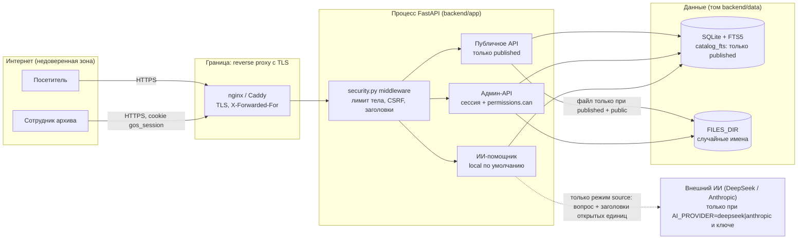

# Безопасность прототипа сайта Госархива ВКО

Документ описывает, от чего защищён прототип, как это реализовано и чем проверено. Каждое
утверждение ссылается на файл или тест; пути - от корня репозитория. Состояние - ветка с
исправлениями по аудиту 12.11.2026 (`docs/security/2026-11-12-audit.md`).

Содержание: 1) назначение и область; 2) модель угроз; 3) соответствие ТЗ; 4) OWASP Top 10;
5) результаты аудита; 6) проверки в CI; 7) ручное воспроизведение; 8) условия тестирования;
9) эксплуатация; 10) известные ограничения и план; 11) раскрытие уязвимостей.

## 1. Назначение и область

Прототип - публичный сайт архива (`web/`), JSON API и административная панель в одном процессе
FastAPI (`backend/app/main.py`), данные - SQLite с FTS5 (`backend/app/schema.sql`).

В области документа:

- публичное API каталога, карточек, файлов, новостей, филиалов, ИИ-помощника;
- вход, сессии, роли (`admin`, `moderator`, `editor`, `branch_admin`), админ-API, импорт CSV/XLSX,
  выгрузка CSV, журнал действий;
- статический фронт (`web/`), заголовки безопасности, конфигурация Docker и CI.

Вне области: TLS-терминация и reverse proxy (настраиваются при развёртывании, раздел 9),
инфраструктура хостинга, сторонние сервисы в браузере (тайлы OpenStreetMap, ссылки на YouTube),
внешний ИИ-провайдер (по умолчанию выключен).

## 2. Модель угроз

### Активы

| Актив | Почему ценен | Где хранится |
|---|---|---|
| Неопубликованные описания (`draft`, `review`, `needs_work`, `approved`, `archived`) | могут содержать непроверенные или персональные данные | `units.pub_status` |
| Файлы с доступом `no_publish` / `needs_check` | права на публикацию не подтверждены | `files.access`, каталог `FILES_DIR` |
| Учётные записи и сессии | дают право публиковать и менять доступ к файлам | `users.password_hash`, `sessions.token_hash` |
| Журнал действий | доказательство, кто и что опубликовал | `audit_log` |
| Целостность каталога | официальный ресурс госучреждения | `units`, `unit_versions` |

### Нарушители

| Нарушитель | Возможности | Цель |
|---|---|---|
| Анонимный посетитель / бот | любые HTTP-запросы к публичному API, перебор id | получить закрытые файлы, черновики; уронить сервис |
| Подбор паролей | массовые попытки входа, смена IP | захват учётной записи |
| Сайт-злоумышленник в браузере сотрудника | запросы с cookie сотрудника (CSRF), встраивание в iframe | действие от имени модератора |
| Авторизованный сотрудник с минимальными правами | редактор или администратор филиала | выйти за пределы роли, филиала или своего объекта |
| Вредоносный файл | загрузка через админку или импорт | XSS через файл, исчерпание памяти, формула в Excel |

### Границы доверия и потоки данных



Границы доверия: (1) интернет -> reverse proxy, (2) proxy -> приложение (приложение доверяет
`X-Forwarded-For` только от адресов из `FORWARDED_ALLOW_IPS`), (3) публичное API -> данные: проверка
`pub_status` и `files.access` на каждом запросе, (4) админ-API -> данные: роль и права на конкретный
объект, (5) приложение -> внешний ИИ: наружу уходят только вопрос и заголовки/сниппеты опубликованных
единиц с публичным файлом; режимы `restricted` (персональные данные) и `no_data` решаются локально до
вызова провайдера, поэтому такие вопросы наружу не уходят вообще.

## 3. Соответствие ТЗ

### ТЗ §7.3 «Безопасность»

| Требование | Как реализовано | Файл | Тест |
|---|---|---|---|
| Защищённое HTTPS-соединение | TLS терминирует reverse proxy (раздел 9). При `COOKIE_SECURE=true` cookie получает `Secure`, ответы - `Strict-Transport-Security: max-age=31536000` | `backend/app/security.py` (`_apply_headers`), `backend/app/routers/auth.py` | `test_hsts_when_cookie_secure`, `test_coop_corp_headers` |
| Безопасная авторизация | cookie-сессия: токен `secrets.token_urlsafe(32)`, в БД только sha256; `HttpOnly`, `SameSite=Lax`; logout удаляет запись; `is_active` проверяется на каждом запросе; одинаковый ответ на неверный логин и неверный пароль | `backend/app/security.py`, `backend/app/routers/auth.py` | `test_login_ok`, `test_logout`, `test_me_401`, `test_login_unknown_user_401_same_message` |
| Хеширование паролей | scrypt N=2^14, r=8, p=5, соль 16 байт, `hmac.compare_digest`; параметры в строке хеша, старые хеши p=1 проверяются | `backend/app/security.py` | `test_scrypt_params_owasp`, `test_legacy_p1_hash_still_verifies` |
| Разграничение прав доступа | матрица `permissions.can` в каждом хендлере; переходы статусов по `TRANSITIONS` + права; `branch_admin` видит и правит только свой филиал; импорт применяет только автор | `backend/app/permissions.py`, `backend/app/workflow.py`, `backend/app/routers/admin.py`, `backend/app/importer.py` | `tests/test_permissions.py` (7 тестов), `test_branch_admin_foreign_unit_404`, `test_import_apply_other_user_403`, `test_invalid_transition_409` |
| Защита от SQL-инъекций | только плейсхолдеры `?`; динамические части SQL - из белых списков (`_EDITABLE_UNIT_FIELDS`, `order_map`); запрос поиска превращается в токены `\w+` в кавычках до FTS5 MATCH | `backend/app/search.py`, `backend/app/routers/admin.py` | `test_search_special_chars_no_500` (17 строк с операторами FTS5) |
| Защита от XSS | фронт выводит данные API через `textContent` / `gosEsc`; CSP `default-src 'self'`, `object-src 'none'`; файлы отдаются как `attachment` с `nosniff`; SVG/HTML к загрузке не принимаются | `web/app.js`, `web/admin/admin.js`, `backend/app/security.py` | `test_security_headers_root`, `test_upload_mime_spoof_rejected` |
| Защита от CSRF | изменяющие `/api/*` требуют заголовок `X-Requested-With: gos` (кросс-доменная форма его не поставит, CORS не открыт) + `SameSite=Lax` | `backend/app/security.py` | `test_csrf_without_header_403` |
| Ограничение попыток входа | 5 неудач за 10 минут на пару логин+IP и 30 неудач за 10 минут на IP -> 429; для неизвестного логина scrypt против фиктивного хеша | `backend/app/routers/auth.py`, `backend/app/config.py` | `test_login_6th_attempt_429`, `test_login_ip_limit_across_usernames`, `test_login_attempts_pruned` |
| Защита административной панели | все `/api/admin/*` за `require_user`/`require_role` + `permissions.can`; `X-Robots-Tag: noindex`, `Cache-Control: no-store`; `/docs`, `/redoc`, `/openapi.json` выключены без `API_DOCS=true` | `backend/app/routers/admin.py`, `backend/app/security.py`, `backend/app/main.py` | `test_noindex_api_admin`, `test_set_access_only_moderator`, `test_api_docs_disabled_by_default` |
| Автоматический выход | сессия истекает через 30 минут без запросов (`SESSION_TTL_MIN`), просроченная запись удаляется | `backend/app/security.py` (`_resolve_session`) | `test_session_expiry` |
| Резервное копирование БД | `make backup` -> `scripts/backup_db.py`: онлайн-копия через `sqlite3.Connection.backup`, ротация 10 копий | `scripts/backup_db.py` | автотеста нет; запуск проверен вручную (раздел 9) |
| Журналирование действий администраторов | `audit_log`: время, пользователь, IP, операция, объект, результат (`ok`/`denied`); ключи `password`, `token`, `secret` вырезаются | `backend/app/audit.py` | `test_no_password_in_audit_log`, `test_import_apply_other_user_403` (запись `denied`) |
| Проверка загружаемых файлов | MIME по сигнатуре байтов (pdf/jpeg/png/webp/tiff), лимит 20 МБ читается с потолком `MAX+1`; общий лимит тела 25 МБ; импорт - 5 МБ, 5000 строк, 64 колонки | `backend/app/security.py` (`detect_mime`), `backend/app/routers/admin.py`, `backend/app/importer.py` | `test_upload_mime_spoof_rejected`, `test_upload_over_limit_413`, `test_body_too_large_413`, `test_import_file_too_large`, `test_import_xlsx_too_many_rows_422` |
| Защита от вредоносных файлов | белый список сигнатур, на диске имя `secrets.token_hex(16)`, отдача только по id с проверкой каталога, `Content-Disposition: attachment`; битый XLSX -> 422; формулы в CSV экранируются. Антивирусной проверки нет - раздел 10 | `backend/app/routers/admin.py`, `backend/app/routers/catalog.py`, `backend/app/importer.py` | `test_upload_mime_spoof_rejected`, `test_import_bad_xlsx_422`, `test_export_csv_neutralizes_formulas` |
| Регулярное обновление компонентов | версии зафиксированы `==` в `requirements*.txt`; CI на каждый push запускает `pip-audit -r requirements.txt`; Leaflet подключён с SRI-хешем | `requirements.txt`, `.github/workflows/ci.yml`, `web/filialy.html` | шаг CI «Аудит зависимостей» |
| Персональные данные по законодательству РК | новый файл получает `needs_check` и не выдаётся; ИИ отказывает на запросы о персональных данных; внешний ИИ выключен по умолчанию | `backend/app/routers/admin.py`, `backend/app/ai/local.py`, `backend/app/ai/providers.py` | `test_upload_pdf_ok` (access `needs_check`), `test_ai_restricted_intent`, `test_ai_local_no_network` |

### Дополнения к ТЗ, разделы 3.1, 3.4, 3.5, 3.6

| Пункт | Требование | Как реализовано | Файл | Тест |
|---|---|---|---|---|
| 3.1 | Раздельные статусы описания и файла | `units.pub_status` и `files.access` (`public`/`no_publish`/`needs_check`); публикация не меняет доступ к файлу | `backend/app/schema.sql`, `backend/app/workflow.py` | `test_publish_does_not_change_files_access` |
| 3.1 | Право доступа на сервере для карточки и файла, включая прямую ссылку и API | карточка не `published` -> 404; файл - только при `published` + `public`, иначе 403 (`no_publish`/`needs_check`) или 404 (черновик) | `backend/app/routers/catalog.py` | `test_draft_card_404`, `test_review_card_404`, `test_archived_card_404`, `test_download_no_publish_403`, `test_download_unpublished_404` |
| 3.1 | При неопределённом праве не открывать доступ | `needs_check` по умолчанию при загрузке, выдача запрещена | `backend/app/routers/admin.py`, `backend/app/routers/catalog.py` | `test_download_needs_check_403`, `test_upload_pdf_ok` |
| 3.1 | FTS только по разрешённым материалам | в `catalog_fts` попадают только `published`; переиндексация при каждом переходе | `backend/app/search.py` | `test_draft_review_archived_not_searchable`, `test_reindex_unit_only_published`, `test_sitemap_no_draft` |
| 3.4 | ИИ только по открытым материалам, без вымышленных шифров | ретривер берёт только `published`, ссылки - на реальные id | `backend/app/ai/retriever.py` | `test_ai_source_with_published_ids`, `test_ai_excludes_draft_and_closed` |
| 3.4 | Ситуации «источник / нет данных / ограниченный доступ» | режимы `source`, `no_data`, `restricted` | `backend/app/ai/local.py` | `test_ai_no_data`, `test_ai_restricted_intent`, `test_ai_restricted_no_public_file_download` |
| 3.4 | Не передавать данные внешнему ИИ без основания | по умолчанию `AI_PROVIDER=local`, сеть не нужна; без ключа - 503, а не тихая отправка; DeepSeek/Anthropic вызываются только для режима `source`, наружу - вопрос и открытые фрагменты, вопросы о персональных данных остаются локальными; сбой провайдера - локальный ответ | `backend/app/ai/providers.py`, `backend/app/routers/ai.py` | `test_ai_local_no_network`, `test_ai_anthropic_no_key_503`, `test_deepseek_no_key_503`, `test_deepseek_payload_only_open_data`, `test_deepseek_restricted_stays_local`, `test_deepseek_error_falls_back_to_local`, `test_default_provider_no_external_call` |
| 3.5 | Права на каждую операцию и конкретный объект, включая филиалы | `permissions.can(user, action, obj)`; `branch_admin` - только свой `branch_id` (правка филиала и чтение единиц); импорт - только автор задачи или admin | `backend/app/permissions.py`, `backend/app/routers/admin.py`, `backend/app/importer.py` | `test_branch_admin_edit_other_branch`, `test_branch_admin_foreign_unit_404`, `test_branch_admin_own_unit_visible`, `test_import_apply_other_user_403` |
| 3.5 | Смена статуса не обходит права на публикацию | переход проверяется по `TRANSITIONS` (409) и по праву целевого статуса (403) | `backend/app/workflow.py` | `test_editor_cannot_publish`, `test_moderator_can_publish`, `test_invalid_transition_409` |
| 3.5 | Неуспешная строка импорта не теряет сохранённые | каждая строка в своём `SAVEPOINT` | `backend/app/importer.py` | `test_import_apply_inserts_8_drafts` |
| 3.5 | Экспорт только разрешённых данных | `export.csv` принудительно `published`, значения-формулы экранируются `'` | `backend/app/routers/admin.py` | `test_export_csv_neutralizes_formulas` |
| 3.5 | Открытые данные публикуют только опубликованные записи | `/api/opendata/catalog.json` и `/api/opendata/catalog.csv` отдают только `pub_status='published'`, без служебных полей (`created_by`, `status_changed_by`, путей файлов), с `has_public_file`; CSV экранирует формулы и идёт с UTF-8 BOM | `backend/app/routers/opendata.py` | `test_opendata_json_published_only`, `test_opendata_no_service_fields`, `test_opendata_csv_formula_neutralized` |
| 3.5 | Журнал: тип операции, id объекта, результат, без паролей и секретов | `audit.log(...)`, `_redact` по ключам | `backend/app/audit.py` | `test_no_password_in_audit_log` |
| 3.6 | Тесты ошибочного входа, закрытых материалов, сбоя внешнего сервиса | автотесты в CI | `tests/` | `test_login_wrong_password_401`, `test_download_no_publish_403`, `test_ai_anthropic_no_key_503`, `test_ai_local_no_network` |
| 3.6 | Контрольная сумма и сведения о загрузке файла | sha256, загрузивший, время, исходное имя в `files`; событие `file.upload` в журнале | `backend/app/routers/admin.py` | `test_upload_pdf_ok` |
| 3.6 | Техническое логирование без секретов | ошибки 500 без трассы в ответе (debug выключен); access-лог uvicorn без тел запросов; журнал без паролей | `backend/app/main.py`, `backend/app/audit.py` | `test_no_password_in_audit_log` |
| 3.6 | Описание восстановления и перехода к промышленной эксплуатации | разделы 9 и 10 этого документа | `docs/SECURITY.md` | - |
| 3.6 | Условия тестирования | раздел 8 | `docs/SECURITY.md` | - |

## 4. Меры по OWASP Top 10 (2021)

**A01 Broken Access Control.** Права проверяются на сервере в каждом хендлере (`backend/app/permissions.py`,
`backend/app/routers/admin.py`), а не скрытием кнопок. Неопубликованное в публичном API неотличимо от
несуществующего (404, `backend/app/routers/catalog.py`). `branch_admin` не читает чужие филиалы,
чужую задачу импорта применить нельзя (`backend/app/importer.py`). Тесты: `tests/test_permissions.py`,
`test_branch_admin_foreign_unit_404`, `test_import_apply_other_user_403`, `test_download_unpublished_404`.

**A02 Cryptographic Failures.** Пароли - scrypt p=5 с солью; токен сессии 256 бит, в БД только sha256
(`backend/app/security.py`). Cookie `Secure` и HSTS включаются `COOKIE_SECURE=true` за TLS-прокси.
Секретов в репозитории нет, `backend/data/` в `.gitignore`.

**A03 Injection.** SQL - только параметры `?`; FTS5-запрос собирается из токенов `\w+` в кавычках,
сбой MATCH уходит в LIKE (`backend/app/search.py`). CSV-инъекция закрыта `_csv_safe`
(`backend/app/routers/admin.py`). XSS - вывод через `textContent`/`gosEsc` (`web/app.js`) и CSP.

**A04 Insecure Design.** Раздельные статусы описания и файла, `needs_check` по умолчанию, индексация
только `published` (`backend/app/schema.sql`, `backend/app/search.py`). ИИ локальный по умолчанию;
внешнему провайдеру - только открытые данные (`backend/app/ai/providers.py`).

**A05 Security Misconfiguration.** Заголовки CSP, `nosniff`, `X-Frame-Options: DENY`,
`Referrer-Policy`, `Permissions-Policy`, COOP/CORP `same-origin` (`backend/app/security.py`).
Swagger и схема выключены без `API_DOCS=true` (`backend/app/main.py`). Docker - пользователь
`appuser`, без `--reload` (`Dockerfile`). `X-Forwarded-For` по умолчанию доверяется только от loopback.

**A06 Vulnerable and Outdated Components.** Пины `==` (`requirements.txt`, `requirements-dev.txt`),
`pip-audit` в CI (`.github/workflows/ci.yml`); на 12.11.2026 известных уязвимостей не найдено.
Leaflet 1.9.4 подключён локально (`web/vendor/leaflet/`), без внешнего CDN.

**A07 Identification and Authentication Failures.** Лимиты по логин+IP и по IP, scrypt против
фиктивного хеша для неизвестного логина, одно сообщение на любую ошибку входа
(`backend/app/routers/auth.py`). Автовыход 30 минут. Вход с демо-паролем помечается флагом
`password_is_default`, админка показывает баннер (`web/admin/admin.js`).

**A08 Software and Data Integrity Failures.** Токен CI только на чтение (`permissions: contents: read`).
SRI для внешних скриптов (сейчас внешних скриптов нет — Leaflet локально). sha256 каждого загруженного файла. Импорт в два шага (preview -> apply) с
привязкой к автору; все импортированные записи попадают в `draft`.

**A09 Security Logging and Monitoring Failures.** `audit_log` пишет и успехи, и отказы (`denied`):
вход, превышение лимита, нехватка роли, скачивание закрытого файла, чужой импорт
(`backend/app/audit.py`). Оповещений нет - раздел 10.

**A10 Server-Side Request Forgery.** Сервер ходит наружу только к API DeepSeek при
`AI_PROVIDER=deepseek` (адрес из `DEEPSEEK_BASE_URL` в окружении) или к API Anthropic при
`AI_PROVIDER=anthropic` с фиксированным адресом SDK (`backend/app/ai/providers.py`); URL от пользователя
сервер не запрашивает. Карта (тайлы OSM) загружается из браузера; внешних fetch-запросов из фронта нет (`connect-src 'self'`).

## 5. Результаты аудита 12.11.2026

Аудит: `docs/security/2026-11-12-audit.md` (код на коммите `0b1a23b`). Тесты - в
`tests/test_security.py`, если не указано иное.

| ID | Серьёзность | Суть | Статус |
|---|---|---|---|
| SEC-01 | Высокая | спецсимволы FTS5 (`ф.1`, `"`, `a(b`, `col:x`) в поиске давали 500 | исправлено: токены в кавычках, потолок 200 символов / 16 токенов, фолбэк на LIKE; `test_search_special_chars_no_500` (17 строк), `test_search_quoted_token_matches`, `test_search_long_query_no_500`, `test_search_fts_error_falls_back_to_like` |
| SEC-02 | Средняя | нет лимита тела, файл читался целиком | исправлено: middleware 413 JSON при `Content-Length` > 25 МБ, 411 для chunked без длины; чтение файла `read(MAX + 1)`; `max_length` в `LoginRequest`, `AiRequest`, `Transition`; `test_body_too_large_413`, `test_upload_over_limit_413`, `test_login_overlong_fields_422` |
| SEC-03 | Средняя | XLSX: все строки в памяти до проверки, битый файл -> 500 | исправлено: стоп на `MAX_ROWS + 1`, не больше 64 колонок, ошибки openpyxl -> 422; `test_import_xlsx_too_many_rows_422`, `test_import_xlsx_too_many_columns_422`, `test_import_bad_xlsx_422` |
| SEC-04 | Средняя | редактор мог применить чужой preview импорта | исправлено: только автор или admin, иначе 403 + `denied` в журнале; `test_import_apply_other_user_403` |
| SEC-05 | Средняя | лимит входов только логин+IP, перечисление логинов по времени ответа | исправлено: счётчик 30/10 мин на IP, scrypt против фиктивного хеша, чистка `login_attempts` старше суток, индекс `(ip, ts)`; `FORWARDED_ALLOW_IPS` описан в разделе 9; `test_login_ip_limit_across_usernames`, `test_login_unknown_user_401_same_message`, `test_login_attempts_pruned` |
| SEC-06 | Средняя | файл черновика отвечал 403 `unpublished`, несуществующий - 404 | исправлено: оба 404 без `reason`, отказ пишется в журнал; `test_download_unpublished_404` (`tests/test_cards.py`) |
| SEC-07 | Средняя | CSV-инъекция в `export.csv` | исправлено: префикс `'` для `= + - @ \t \r`; `test_export_csv_neutralizes_formulas` |
| SEC-08 | Средняя | общий демо-пароль у всех ролей, смены пароля нет | частично: флаг `password_is_default` в `/login` и `/me`, баннер в админке, предупреждение seed; `test_login_and_me_report_default_password`. Смена пароля через API - план (раздел 10) |
| SEC-09 | Низкая | scrypt p=1 ниже OWASP | исправлено: p=5, старые хеши проверяются; `test_scrypt_params_owasp`, `test_legacy_p1_hash_still_verifies` |
| SEC-10 | Низкая | CSP с `'unsafe-inline'`, нет HSTS/COOP/CORP | частично: HSTS при `COOKIE_SECURE`, COOP/CORP `same-origin`; `test_hsts_when_cookie_secure`, `test_coop_corp_headers`. Nonce для inline-скриптов - план |
| SEC-11 | Низкая | открыты `/docs`, `/redoc`, `/openapi.json` | исправлено: только при `API_DOCS=true`; `test_api_docs_disabled_by_default`, `test_api_docs_enabled_with_flag` |
| SEC-12 | Низкая | неограниченные `per_page`, отрицательный `page` | исправлено: админ-списки `1 <= per_page <= 100`, `page >= 1`; публичный поиск и фонды `page <= 100000`; `test_admin_pagination_clamped` |
| SEC-13 | Низкая | `branch_admin` читал черновики, версии и файлы всех филиалов | исправлено: список по своему `branch_id`, чужая единица -> 404; `test_branch_admin_foreign_unit_404`, `test_branch_admin_own_unit_visible` |
| SEC-14 | Низкая | CI без `permissions`, без аудита зависимостей, версии не зафиксированы | исправлено: `permissions: contents: read`, шаг `pip-audit -r requirements.txt`, пины `==` |
| SEC-15 | Низкая | HTML новостей без санитайзера | принятый риск: источник - только seed со старого сайта, проверен на `<script`, `on*=`, `javascript:`, `<iframe`; редактирования новостей нет. План - allowlist-санитайзер при сохранении |
| SEC-16 | Низкая | sitemap/robots строятся из заголовка `Host` | план: `BASE_URL` или `TrustedHostMiddleware`; до этого `server_name` в прокси отсекает чужие Host |
| SEC-17 | Низкая | сессия без абсолютного срока, cookie не продлевается | план: абсолютный лимит 12 ч, фоновая чистка `sessions`, продление cookie |
| SEC-18 | Низкая | нетипизированные тела админ-запросов (`dict`) могут дать 500 | план: pydantic-модели для units/branches/users |
| SEC-19 | Инфо | фонды видны без опубликованных единиц | план: показывать фонд при наличии опубликованного |
| SEC-20 | Инфо | внешний ИИ без системного промпта | для DeepSeek закрыто: system-промпт (только по фрагментам, инструкции в данных не выполнять) и явные разделители вопроса и фрагментов, подделка границ из данных обезврежена; `test_deepseek_payload_only_open_data`, `test_deepseek_delimiters_not_forgeable`. Для Anthropic - план; по умолчанию провайдер `local` |
| SEC-21 | Инфо | мелочи журнала и эксплуатации (`ip` не везде, число единиц в `/api/health`, compose без `read_only`/`cap_drop`) | план |

Отклонения от предложений аудита:

- SEC-02: кроме 413 по `Content-Length` добавлен ответ 411 на chunked-запрос без длины -
  иначе лимит обходится отказом от заголовка.
- SEC-01: в LIKE-фолбэке к нормализованным вариантам добавлен исходный запрос - `LIKE` в SQLite
  не сворачивает регистр кириллицы, и без этого фолбэк находил меньше FTS.
- SEC-08: признак демо-пароля в `/me` вычисляется сверкой хеша с `DEMO_PASSWORD` (кэш по строке
  хеша), без новой колонки в схеме.

### Проверено, проблем нет

| Область | Почему всё в порядке |
|---|---|
| SQL-инъекции | все запросы параметризованы `?`; динамика только по белым спискам полей, `sort` через `order_map`, экспорт принудительно `published` |
| Доступ к карточке и файлу | сервер проверяет `pub_status` карточки и `pub_status` + `files.access` файла; `needs_check` не открывает доступ |
| Утечки неопубликованного | FTS индексирует только published; фильтры в sitemap, новостях, филиалах, ретривере ИИ; внешнему ИИ - только открытые фрагменты |
| Path traversal | на диске `secrets.token_hex(16)`; при отдаче `Path.name` + `resolve()` + проверка каталога |
| Тип файла | MIME по сигнатуре байтов, только pdf/jpeg/png/webp/tiff; SVG/HTML/EXE отклоняются; `Content-Disposition: attachment` + `nosniff` |
| CSRF | обязательный заголовок на изменяющих `/api/*` + `SameSite=Lax`; CORS не открыт |
| Сессии | 256-битный токен, в БД sha256; HttpOnly, SameSite, Secure по env; logout удаляет запись; `is_active` на каждом запросе; автовыход 30 мин; фиксация невозможна |
| Роли и workflow | `permissions.can` в каждом хендлере, переходы по `TRANSITIONS` + права целевого статуса; отказы в журнале |
| Журнал | тип операции, объект, результат; `password/token/secret` вырезаются |
| XSS во фронте | данные API через `gosEsc`/`textContent`; markdown сначала экранируется; ответ ИИ экранируется |
| Секреты | ключей в репозитории нет, `backend/data/` в `.gitignore` |
| Инфраструктура | Docker non-root, healthcheck, БД в томе, без `--reload`/debug, `X-Forwarded-For` по умолчанию не доверяется |
| Ошибки | 500 без трассы, `debug` выключен |

## 6. Автоматические проверки в CI

`.github/workflows/ci.yml` на каждый push и pull request:

- `backend`: `pip-audit -r requirements.txt`, `ruff check`, `ruff format --check`, `pytest -q`
  (142 теста), seed + uvicorn + curl-smoke `/api/health` и поиска;
- `web`: `html-validate`, `scripts/check_links.py web`;
- `docker`: сборка образа.

Тесты безопасности - 92 из 142:

| Файл | Тестов | Что проверяют |
|---|---|---|
| `tests/test_security.py` | 41 (17 из них - параметры `test_search_special_chars_no_500`) | регрессия по SEC-01...SEC-13 |
| `tests/test_security_headers.py` | 4 | CSP и заголовки на `/` и `/api`, noindex админки, CSRF |
| `tests/test_auth.py` | 7 | вход, неверный пароль, 429, logout, `/me`, автовыход |
| `tests/test_permissions.py` | 7 | публикация, правка по статусу, филиалы, доступ к файлу |
| `tests/test_cards.py` | 9 | 404 для неопубликованных карточек, выдача и отказы по файлам |
| `tests/test_ai.py` | 5 | `test_ai_restricted_intent`, `test_ai_restricted_no_public_file_download`, `test_ai_excludes_draft_and_closed`, `test_ai_anthropic_no_key_503`, `test_ai_local_no_network` |
| `tests/test_ai_deepseek.py` | 10 (3 из них - параметры `test_deepseek_error_falls_back_to_local`) | ключ, состав исходящего запроса, разделители, restricted/no_data локально, таймаут/500/сеть -> фолбэк, по умолчанию без внешних вызовов |
| `tests/test_import.py` | 2 | `test_import_file_too_large`, `test_import_no_permission_403` |
| `tests/test_search.py` | 2 | `test_draft_review_archived_not_searchable`, `test_reindex_unit_only_published` |
| `tests/test_workflow.py` | 2 | `test_invalid_transition_409`, `test_publish_does_not_change_files_access` |
| `tests/test_admin.py` | 1 | `test_upload_mime_spoof_rejected` |
| `tests/test_audit.py` | 1 | `test_no_password_in_audit_log` |
| `tests/test_seo.py` | 1 | `test_sitemap_no_draft` |

## 7. Как воспроизвести вручную

Сервер с демо-данными (команды выполнены 12.11.2026, вывод ниже - фактический):

```sh
rm -f /tmp/sec.db; DB_PATH=/tmp/sec.db FILES_DIR=/tmp/secfiles .venv/bin/python -m backend.seed
DB_PATH=/tmp/sec.db FILES_DIR=/tmp/secfiles .venv/bin/uvicorn backend.app.main:app --port 8801 &
B=http://localhost:8801; G='X-Requested-With: gos'; J='Content-Type: application/json'
alias c="curl --noproxy '*' -s"
```

Seed печатает: `ВНИМАНИЕ: пользователи созданы с демо-паролем по умолчанию. Перед развёртыванием
задайте SEED_PASSWORD или смените пароли.`

**Изменяющий запрос без `X-Requested-With` -> 403**

```sh
c -w ' HTTP %{http_code}\n' -X POST $B/api/auth/login -H "$J" -d '{"username":"editor","password":"Demo-2026!"}'
# {"error":"csrf","detail":"Требуется заголовок X-Requested-With: gos"} HTTP 403
```

**Вход: флаг демо-пароля**

```sh
c -c ed.jar -X POST $B/api/auth/login -H "$G" -H "$J" -d '{"username":"editor","password":"Demo-2026!"}'
# {"user":{"id":3,"username":"editor","role":"editor","branch_id":null,"display_name":"Редактор"},"password_is_default":true}
```

**Черновик и файл черновика -> 404** (редактор создаёт единицу в `draft` и прикладывает PDF)

```sh
c -b ed.jar -X POST $B/api/admin/units -H "$G" -H "$J" \
  -d '{"code":"SEC-DEMO-1","title_ru":"Черновик для проверки","level":"delo","fond_id":1,"years":[1950]}'   # id=96
printf '%%PDF-1.4 demo' > demo.pdf
c -b ed.jar -X POST $B/api/admin/units/96/files -H "$G" -F "file=@demo.pdf;type=application/pdf"          # id=3
c -w ' HTTP %{http_code}\n' $B/api/catalog/units/96        # {"detail":"not found"} HTTP 404
c -w ' HTTP %{http_code}\n' $B/api/files/3/download        # {"detail":"not found"} HTTP 404
c -w ' HTTP %{http_code}\n' $B/api/files/999999/download   # {"detail":"not found"} HTTP 404
```

**Файл `no_publish` опубликованной единицы -> 403**

```sh
c -w ' HTTP %{http_code}\n' $B/api/files/2/download
# {"error":"restricted","reason":"no_publish","howto":"reading_room"} HTTP 403
```

**Поиск со спецсимволами FTS5 -> 200**

```sh
for q in 'ф.1' '"' 'a(b' 'x*' 'col:x' "o'neil" 'привет!'; do
  c -o /dev/null -w "$q HTTP %{http_code}\n" -G $B/api/catalog/search --data-urlencode "q=$q"; done
# все семь - HTTP 200; до исправления SEC-01 - 500
c -G $B/api/catalog/search --data-urlencode 'q=ф.1'
# total 95, первые: 'ф.1508, оп.1', 'ф.1530, оп.1', 'Ф. 77-Ф, оп. 1, д. 14'
```

**Тело больше 25 МБ -> 413**

```sh
head -c 27000000 /dev/zero > big.bin
c -w ' HTTP %{http_code}\n' -X POST $B/api/ai/ask -H "$G" -H "$J" --data-binary @big.bin
# {"error":"too_large","detail":"Тело запроса больше 25 МБ"} HTTP 413
```

**Подбор пароля -> 429 на шестой попытке; неизвестный логин отвечает так же**

```sh
for i in 1 2 3 4 5 6; do c -o /dev/null -w "попытка $i: HTTP %{http_code}\n" -X POST $B/api/auth/login \
  -H "$G" -H "$J" -d '{"username":"moderator","password":"wrong"}'; done
# попытки 1-5: HTTP 401, попытка 6: HTTP 429
c -X POST $B/api/auth/login -H "$G" -H "$J" -d '{"username":"ghost","password":"wrong"}'
c -X POST $B/api/auth/login -H "$G" -H "$J" -d '{"username":"admin","password":"wrong"}'
# оба: {"detail":"Неверное имя пользователя или пароль"} HTTP 401
```

**Заголовки безопасности**

```sh
curl --noproxy '*' -sI $B/
# content-security-policy: default-src 'self'; object-src 'none'; base-uri 'self'; frame-ancestors 'none'; ...
# x-content-type-options: nosniff
# referrer-policy: strict-origin-when-cross-origin
# x-frame-options: DENY
# permissions-policy: camera=(), microphone=(), geolocation=()
# cross-origin-opener-policy: same-origin
# cross-origin-resource-policy: same-origin
```

`Strict-Transport-Security` в этом выводе нет, потому что `COOKIE_SECURE=false` (локальный HTTP);
при `COOKIE_SECURE=true` заголовок появляется (`test_hsts_when_cookie_secure`).

**Документация API выключена**

```sh
for p in /docs /redoc /openapi.json; do c -o /dev/null -w "$p HTTP %{http_code}\n" $B$p; done
# /docs HTTP 404, /redoc HTTP 404, /openapi.json HTTP 404
```

**CSV-экспорт: формула экранирована**

```sh
sqlite3 /tmp/sec.db "update units set author='=HYPERLINK(\"http://evil\",\"x\")' where id=1"
c -c adm.jar -o /dev/null -X POST $B/api/auth/login -H "$G" -H "$J" -d '{"username":"admin","password":"Demo-2026!"}'
c -b adm.jar $B/api/admin/export.csv | grep HYPERLINK
# 1,"ф.1508, оп.2",fond,...,"'=HYPERLINK(""http://evil"",""x"")",published
```

## 8. Условия тестирования

| Параметр | Значение |
|---|---|
| Дата | 12.11.2026 |
| ОС и устройство | Fedora Linux 44, x86_64, ноутбук разработчика; CI - `ubuntu-latest` GitHub Actions |
| Python и зависимости | Python 3.12 (`uv venv -p 3.12`), версии из `requirements*.txt`: FastAPI 0.162.5, uvicorn 0.54.0, pydantic 2.14.3, python-multipart 0.0.33, openpyxl 3.1.5 |
| СУБД | SQLite из стандартной библиотеки Python, FTS5 доступен (`/api/health` -> `"fts5": true`) |
| Конфигурация | значения по умолчанию из `backend/app/config.py`: `AI_PROVIDER=local`, `COOKIE_SECURE=false`, `API_DOCS=false`, `SESSION_TTL_MIN=30`, `LOGIN_MAX_ATTEMPTS=5`, `LOGIN_WINDOW_MIN=10`, `LOGIN_IP_MAX_ATTEMPTS=30` |
| Данные ручной проверки | `python -m backend.seed`: 13 филиалов, 89 фондов (81 личный), 95 единиц, 638 новостей, 2 файла, 4 пользователя |
| Данные автотестов | фикстура `load_fixture`: 3 филиала, 2 фонда, 6 единиц (3 published, draft, review, archived), 3 файла (`public`, `no_publish`, `needs_check`), 4 пользователя |
| Подключение | локально, HTTP на 127.0.0.1:8801, без прокси (`curl --noproxy '*'`); внешние сервисы не нужны |
| Браузер для фронта | статические проверки `html-validate@9` и `scripts/check_links.py`; `node --check` для `web/admin/admin.js` |

## 9. Эксплуатация

### Переменные окружения, влияющие на безопасность

| Переменная | По умолчанию | Назначение |
|---|---|---|
| `COOKIE_SECURE` | `false` | `true` на проде за TLS: cookie с `Secure` и заголовок HSTS |
| `SESSION_TTL_MIN` | `30` | автовыход после бездействия, минут |
| `LOGIN_MAX_ATTEMPTS` / `LOGIN_WINDOW_MIN` | `5` / `10` | неудачи на пару логин+IP за окно |
| `LOGIN_IP_MAX_ATTEMPTS` | `30` | неудачи с одного IP на все логины за окно |
| `API_DOCS` | `false` | `true` открывает `/docs`, `/redoc`, `/openapi.json`; `make dev` включает для разработки |
| `AI_PROVIDER` | `local` | `deepseek` или `anthropic` отправляет вопрос и открытые фрагменты внешнему провайдеру (только режим `source`) |
| `DEEPSEEK_API_KEY` | не задан | ключ DeepSeek; хранить в секретах окружения, не в репозитории |
| `DEEPSEEK_MODEL` / `DEEPSEEK_BASE_URL` | `deepseek-chat` / `https://api.deepseek.com` | модель и адрес OpenAI-совместимого API |
| `ANTHROPIC_API_KEY` | не задан | ключ провайдера; хранить в секретах окружения, не в репозитории |
| `SEED_PASSWORD` | `Demo-2026!` | пароль пользователей seed; на проде задать свой |
| `FORWARDED_ALLOW_IPS` | `127.0.0.1` | адреса прокси, которым uvicorn верит в `X-Forwarded-For` |
| `DB_PATH`, `FILES_DIR` | `backend/data/...` | БД и файлы; каталог должен быть вне веб-корня (по умолчанию так) |

### Reverse proxy с TLS

Приложение слушает HTTP; наружу его выставляет прокси с TLS. Пример nginx:

```nginx
server {
    listen 443 ssl http2;
    server_name arhiv.example.kz;            # чужие Host не доходят до приложения (SEC-16)
    ssl_certificate     /etc/letsencrypt/live/arhiv.example.kz/fullchain.pem;
    ssl_certificate_key /etc/letsencrypt/live/arhiv.example.kz/privkey.pem;
    client_max_body_size 25m;                # тот же лимит, что в приложении
    location / {
        proxy_pass http://127.0.0.1:8000;
        proxy_set_header Host $host;
        proxy_set_header X-Forwarded-For $remote_addr;
        proxy_set_header X-Forwarded-Proto https;
    }
}
server { listen 80; server_name arhiv.example.kz; return 301 https://$host$request_uri; }
```

`FORWARDED_ALLOW_IPS` должен содержать адрес прокси, как его видит приложение (для Docker - адрес
шлюза сети контейнера). Без этого все клиенты выглядят как один IP прокси, и лимит входов
срабатывает на всех сразу; с `*` при прямом доступе к порту клиент подделает свой IP. Порт
приложения не должен быть доступен напрямую из интернета.

### Бэкап и восстановление

```sh
make backup                                       # backend/data/backups/archive-ГГГГММДД-ЧЧММСС.db, хранится 10 копий
python3 scripts/backup_db.py --db /tmp/sec.db --dir /tmp/sec-bk   # проверено 12.11.2026: "бэкап создан: ..."
```

Копия снимается онлайн через `sqlite3.Connection.backup` - сервер останавливать не нужно.
Файлы (`FILES_DIR`) скрипт не копирует - их копировать отдельно (`rsync -a backend/data/files/ ...`).
Восстановление: остановить приложение, скопировать нужный `archive-*.db` в `DB_PATH`, вернуть
каталог файлов, запустить приложение и проверить `/api/health` и поиск. Для Docker - те же шаги
внутри тома `archive-data`. Копии стоит выносить на другой хост (в прототипе не настроено).

## 10. Известные ограничения и план до промышленной версии

| Ограничение | Риск | План |
|---|---|---|
| Нет смены пароля через API и UI (SEC-08) | демо-пароль остаётся, если админ не задал `SEED_PASSWORD` | `POST /api/auth/password`: минимум 10 символов, сброс других сессий, запись в журнал; управление пользователями в админке |
| CSP `script-src 'unsafe-inline'` (SEC-10) | при найденной XSS inline-скрипт выполнится | вынести inline-скрипты в файлы или выдавать nonce на каждый ответ, убрать `'unsafe-inline'` |
| HTML новостей без санитайзера (SEC-15) | при появлении редактирования новостей - хранимая XSS | allowlist-санитайзер при сохранении |
| sitemap/robots из `Host` (SEC-16) | подмена ссылок в sitemap без `server_name` на прокси | `BASE_URL` в настройках или `TrustedHostMiddleware` |
| Сессии без абсолютного срока (SEC-17) | активная сессия живёт бесконечно | лимит 12 ч, фоновая чистка, продление cookie |
| Нетипизированные тела админ-запросов (SEC-18) | 500 на некорректных типах | pydantic-модели |
| Фонды без опубликованных единиц видны (SEC-19) | раскрытие названия фонда | фильтр по наличию опубликованного |
| Внешний ИИ Anthropic без системного промпта (SEC-20) | prompt injection через текст единиц | system-промпт и разделители, как у DeepSeek |
| Журнал и эксплуатация (SEC-21) | неполный IP в журнале, лишние сведения в `/api/health`, контейнер без `read_only`/`cap_drop` | дописать IP, убрать счётчик, ужесточить compose |
| Нет антивирусной проверки загрузок | вредоносный PDF с разрешённой сигнатурой | ClamAV перед сохранением, карантин до `public` |
| Нет двухфакторной аутентификации и SSO | компрометация пароля = доступ | TOTP для admin/moderator или вход через корпоративный IdP |
| Нет оповещений по журналу | подбор или массовые отказы замечают поздно | выгрузка журнала в SIEM, алерты на `denied` и 429 |
| SQLite, один процесс | лимиты входов и сессии не разделяются между репликами | PostgreSQL и общий счётчик при горизонтальном масштабировании |
| Нет автоматических обновлений зависимостей | уязвимость заметят только при следующем push | Dependabot/Renovate, ежедневный `pip-audit` по расписанию |
| Бэкап на том же диске, файлы не копируются | потеря диска = потеря данных | копия БД и `FILES_DIR` на другой хост, проверка восстановления по графику |

Переход к промышленной эксплуатации также требует оценки по требованиям РК к государственным
информационным системам и защите персональных данных; прототип её не проходил.

## 11. Политика раскрытия уязвимостей

Порядок сообщения - в `SECURITY.md` в корне репозитория. Коротко: не публиковать детали в открытых
issue, писать владельцу репозитория приватно (GitHub Security Advisory «Report a vulnerability»),
приложить шаги воспроизведения. Подтверждение - в течение 3 рабочих дней, исправление высокой
серьёзности - в течение 14 дней, после исправления - запись в разделе 5 этого документа.
